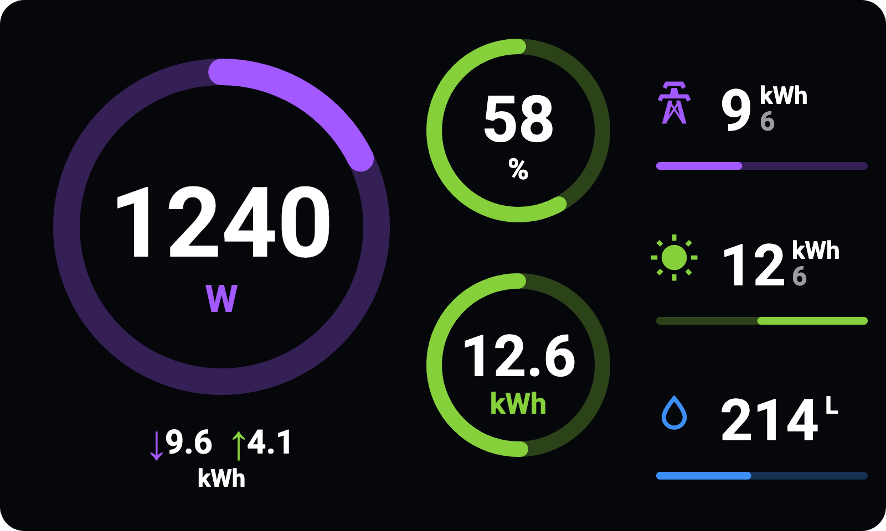
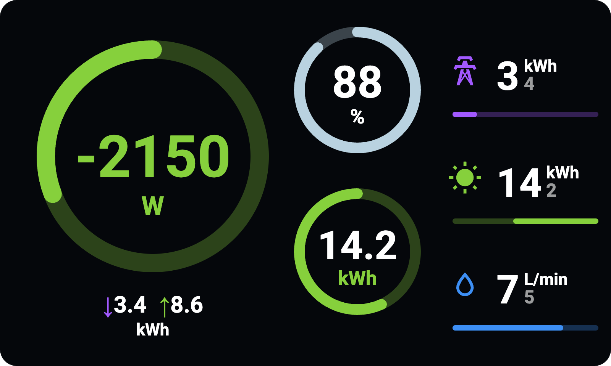
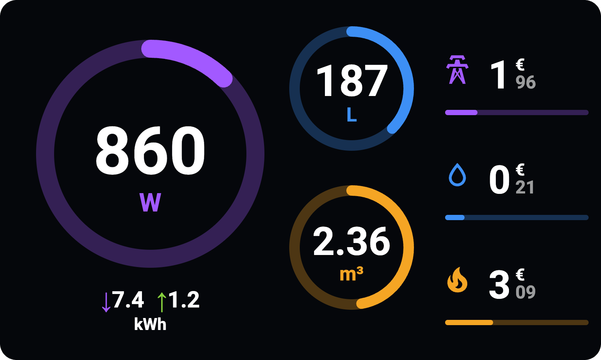

# HomeWizard Display Card

*[Nederlandse versie](README.nl.md)*


A Home Assistant dashboard card that recreates the **Usage Overview** screen of the HomeWizard
Energy Display: three circles and three rows that show electricity, solar, home battery, water
and gas, now, today or in costs.

 



* **Set up like the display.** Each circle and row shows a source (main connection, solar
  panels, home battery, water, gas, electricity use, self-sufficiency, a socket or kWh meter, or
  any sensor) in a mode: **Now**, **Today**, **Auto** or **Costs**, with a maximum goal.
* **Works with your Energy settings.** Grid (also with two tariffs), solar, home batteries, water,
  gas and their prices are picked up automatically. Today's values come from Home Assistant's
  statistics, like the Energy dashboard, and keep counting live in between. Usually no helpers
  needed.
* **Looks like the display.** Taking energy is purple: rings fill clockwise, bars from left to
  right. Delivering (returning to the grid, solar, a battery that discharges) is green: rings fill
  counterclockwise, bars from right to left.
* **Visual editor** in English and Dutch, set up like the HomeWizard app. Numbers follow the number
  format of your profile. Background colour of your choice, by day and by night.
* **One small file, no dependencies.** Fits in a sections view and scales to any width.

The data comes from Home Assistant, for example from the official HomeWizard integration. You
don't need a HomeWizard Energy Display, and other meters work too.

## Installation

### Marketplace (Home Assistant 2026.11 and later)

[](https://my.home-assistant.io/redirect/marketplace_repository/?owner=timoverwoest&repository=homewizard_display_card&category=plugin)

The card has been submitted to the Marketplace catalog. Until it is listed, add it from its link:

1. Select the button above. Or go to **Settings → Marketplace**, select **Add from link** in the
   upper-right corner, enter `timoverwoest/homewizard_display_card` and select **Add**.
2. If you are asked to, connect your GitHub account (custom repositories need it). If the type is
   not detected, choose **Dashboard**.
3. Select **Install**. The Marketplace adds the dashboard resource for you.
4. Reload your browser.

Once the card is in the catalog, you can simply search for **HomeWizard Display Card** under
**Settings → Marketplace**. Updates appear under **Settings → Updates**.

### HACS (Home Assistant 2026.10 and older)

1. Open HACS, select **⋮ → Custom repositories**, enter
   `https://github.com/timoverwoest/homewizard_display_card` with type **Dashboard** and select
   **Add**.
2. Open **HomeWizard Display Card**, select **Download** and reload your browser.

### Manual

1. Download `homewizard_display_card.js` from the
   [latest release](https://github.com/timoverwoest/homewizard_display_card/releases/latest)
   (it is in the source code) and put it in `/config/www/`.
2. Go to **Settings → Dashboards → ⋮ → Resources** and add
   `/local/homewizard_display_card.js?v=0.1.1` as a **JavaScript module**.
3. Reload your browser. Raise `?v=` with every new version.

## Configuration

Add the card from the card picker (search for "HomeWizard"). The editor is set up like the display
settings in the HomeWizard app: one section per circle and row (**Circle 1–3**, **Top**,
**Middle**, **Bottom**) with what it shows, the mode and the maximum goals, then the background
colour, the sensors and the other colours.

In YAML, the shortest version is:

```yaml
type: custom:homewizard-display-card
```

That gives the display's default Usage Overview, filled from your
[Energy settings](https://my.home-assistant.io/redirect/config_energy/):

| Position | Key | Default |
|----------|-----|---------|
| Circle 1 (large) | `circle_1` | Main connection, now, goal 7000 W |
| Circle 2 | `circle_2` | Home battery, goal 100 % |
| Circle 3 | `circle_3` | Solar panels, today, goal 25 kWh |
| Top | `top` | Main connection, today, goal 25 kWh |
| Middle | `middle` | Solar panels, today, goal 25 kWh |
| Bottom | `bottom` | Water, auto, goals 10 L/min and 500 L |

### What a circle or row can show

Each position takes `source`, `mode` and the goals that belong to that mode.

| `source` | Now (`goal_now`) | Today (`goal_today`) | Auto | Costs (`goal_cost`) |
|----------|------------------|----------------------|------|---------------------|
| `grid`: main connection | Power in W; green when returning (7000 W) | Taken from the grid, kWh (25 kWh) | – | Today's costs minus compensation (10) |
| `solar`: solar panels | Production in W (5000 W) | Production in kWh (25 kWh) | ✓ | – |
| `battery`: home battery | State of charge in % (100 %) | – | – | – |
| `water` | Flow in L/min (10 L/min) | Litres (500 L) | ✓ | Today's costs (2) |
| `gas` | Flow in m³/h (2 m³/h) | m³, or kWh for a gas meter in kWh (5) | ✓ | Today's costs (10) |
| `consumption`: electricity use of the house | W (7000 W) | kWh (25 kWh) | – | – |
| `self_sufficiency`: share not taken from the grid | % (100 %) | % (100 %) | – | – |
| `device`: Energy Socket, kWh Meter and the like | W from `power`; negative = producing (3000 W) | kWh from `energy` (10 kWh) | ✓ | – |
| `entity`: any sensor, for example a temperature | Value and unit of `entity` (100) | – | – | – |
| `none` | Nothing | | | |

* **Auto** shows *now* while something flows or produces, and *today* when that is 0.
* **Costs** use the prices in your Energy settings; Home Assistant makes the cost sensors itself.
  The currency follows your Home Assistant settings. A negative value (you earned more than you
  paid) is shown in green.
* **Electricity use** and **self-sufficiency** are worked out from the grid, solar panels and
  home batteries in your Energy settings, the same way the Energy dashboard does it.
* Under the large ring, when it shows the main connection, you see ↓ taken and ↑ returned today,
  like on the display. While you return power, a large ring in *today* mode shows what you
  returned today.
* A goal is the value at which the ring or bar is full. `color` gives one circle or row a colour
  of its own.

### Sensors

Every value can come from an entity of your own; fields you leave empty are filled in from the
Energy settings.

| Option | Description |
|--------|-------------|
| `grid_power` | Power of the grid connection: positive = taking from the grid, negative = returning. W or kW. |
| `grid_import`, `grid_export` | Meter(s) for energy taken from or returned to the grid. One entity or a list, for example one per tariff. |
| `solar_power`, `solar_energy` | Power and production meter(s) of the solar panels. |
| `battery_soc` | State of charge (%). A list of several batteries gives their average. |
| `battery_power` | Battery power. A list is added up. Used to show when the battery delivers. |
| `battery_power_sign` | `discharge_positive` (default, Home Assistant's convention) or `charge_positive` if your `battery_power` sensor counts **charging** as positive, like the HomeWizard Plug-In Battery. Batteries from the Energy settings always follow Home Assistant's convention. |
| `water`, `water_flow` | Water meter(s) and the flow sensor (L/min, m³/h and so on). |
| `gas`, `gas_flow` | Gas meter(s) and a flow sensor (m³/h). |
| `use_energy_settings` | `false`: only use the entities you set yourself. Default `true`. |

Meters can be total meters, the kind you use in the Energy settings, or daily meters such as a
utility meter that resets at midnight. The card asks Home Assistant's statistics for today's change
in both cases. An entity without statistics is shown as it is.

### Colours

| Option | Default | Used for |
|--------|---------|----------|
| `color_background` | `#05070b` (the black of the display) | Background by day (light theme); any hex colour such as `#000000` or `#f4f4f4` |
| `color_background_dark` | same as by day | Background by night (dark theme) |
| `color_grid` | `#a259ff` | Main connection and electricity use |
| `color_delivery` | `#86d03c` | Delivery: returning, solar, a discharging battery, self-sufficiency |
| `color_battery` | `#b9d2e0` | Home battery while it does not deliver, and own sensors |
| `color_water` | `#3d8ff5` | Water |
| `color_gas` | `#f5a524` | Gas |
| `color_text` | automatic | Numbers: white on a dark background, near-black on a light one |

**Day and night.** The card follows the light or dark mode of Home Assistant, like the rest of
your dashboard: under your profile, **Theme** set to *Auto* follows your device, or choose *Light*
or *Dark*. In dark mode the card uses `color_background_dark`; leave it empty to keep one
background. For example a light card by day and the black of the display at night:

```yaml
type: custom:homewizard-display-card
color_background: "#f4f4f4"
color_background_dark: "#05070b"
```

### Example

Gas in circle 3, water with its flow sensor at the bottom, and a slightly lighter background:

```yaml
type: custom:homewizard-display-card
circle_1:
  source: grid
  mode: now
  goal_now: 7000
circle_3:
  source: gas
  mode: today
  goal_today: 4
bottom:
  source: water
  mode: auto
  goal_now: 10
  goal_today: 500
water_flow: sensor.watermeter_active_water_usage
gas: sensor.p1_meter_total_gas
color_background: "#101418"
```

## Do I need helper sensors?

Usually not. The card works out these by itself: today's totals (from the statistics), costs
(from the Energy settings), electricity use and self-sufficiency, several tariffs (added up) and
several batteries (average charge, total power). You only need a helper in these cases. Helpers
are made under **Settings → Devices & services → Helpers → Create helper**.

| When | Why | How |
|------|-----|-----|
| You want water or gas **now** or **auto**, but the meter has no flow sensor (for example the P1 gas meter, or a water meter without one) | Now needs a flow | **Derivative sensor** on the water or gas meter. Time unit **minutes** for water (gives m³/min, the card converts it to L/min), **hours** for gas (gives m³/h). A time window of 5 minutes smooths the steps of the meter. Put it in `water_flow` or `gas_flow`. |
| You want solar **now**, but the inverter only has an energy meter | Now needs power | **Derivative sensor** on the solar meter with time unit **hours** (kWh/h is kW). Put it in `solar_power`. |
| Your grid power sensor counts returning as positive, or import and export are two sensors | The card wants one sensor, positive = taking | Best: enter it in the Energy settings under the grid's power (as *inverted* or as *two sensors*); Home Assistant then makes the right sensor and the card finds it. Otherwise a **Template sensor** with `{{ -(states('sensor.grid_power') | float(0)) }}` or import minus export. |
| You want **costs**, but have no prices in the Energy settings | Costs come from Home Assistant's cost sensors | No helper: add the price (fixed, or an entity with the current price) to the meter in the Energy settings. |
| A meter has no statistics (no state class) | Today comes from the statistics | **Utility meter** on that meter with meter reset cycle *daily*; it does have statistics. |
| You want gas, but it is not in the Energy settings | – | No helper: set `gas` to your gas meter. For gas costs, add gas with its price to the Energy settings. |

Your battery counts charging as positive? No helper: set `battery_power_sign: charge_positive`.

## How "today" works

The card reads today's change of each meter from the recorder statistics, the same data the
Energy dashboard uses. The day starts at midnight in the time zone of Home Assistant. Statistics
are stored every 5 minutes; in between, the card adds what the meter counted since the last
statistic, so the numbers keep moving.

The HomeWizard Energy Display resets its day totals at 2:00 at night, so between midnight and
two o'clock, and for the totals of the day, its numbers can differ from the card's.

## Notes

* The layout is fixed to the Usage Overview screen: three circles and three rows.
* Made with the HomeWizard integration in mind (P1 meter, water meter, Energy Socket, kWh Meter,
  Plug-In Battery), but any sensor with a supported unit works.

## Development

The card is a single JavaScript file without a build step. Tests for the logic:

```bash
node tests/run-node.js
```

On a Mac without Node, JavaScriptCore works too:

```bash
/System/Library/Frameworks/JavaScriptCore.framework/Versions/A/Helpers/jsc homewizard_display_card.js tests/test.js
```

For a visual check, serve the repository root (for example `python3 -m http.server 8765`) and open
`http://localhost:8765/tests/demo.html`. That page uses a fake Home Assistant with demo values.

## Credits and disclaimer

Inspired by the HomeWizard Energy Display. HomeWizard and HomeWizard Energy are trademarks of
HomeWizard B.V. This is an independent community project; it is not affiliated with, endorsed by,
or sponsored by HomeWizard. The logo is an original design and not the HomeWizard logo.

Icons in the card: [Material Design Icons](https://pictogrammers.com/library/mdi/) by
Pictogrammers, Apache License 2.0.

## License

MIT, see [LICENSE](LICENSE).
