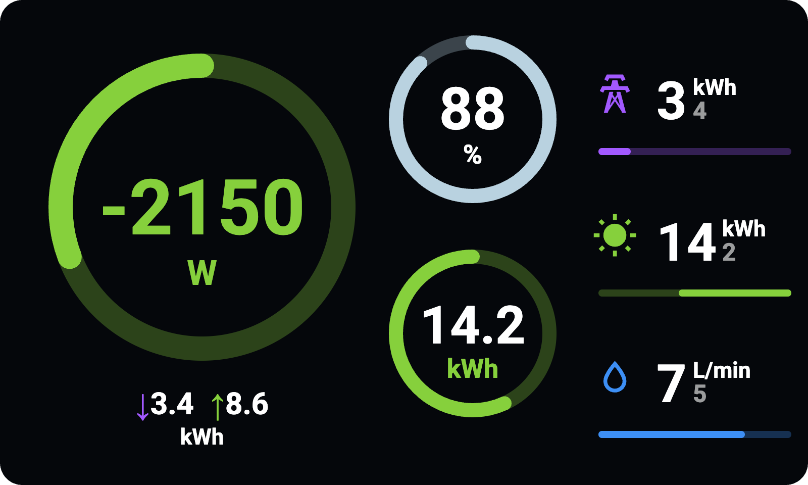
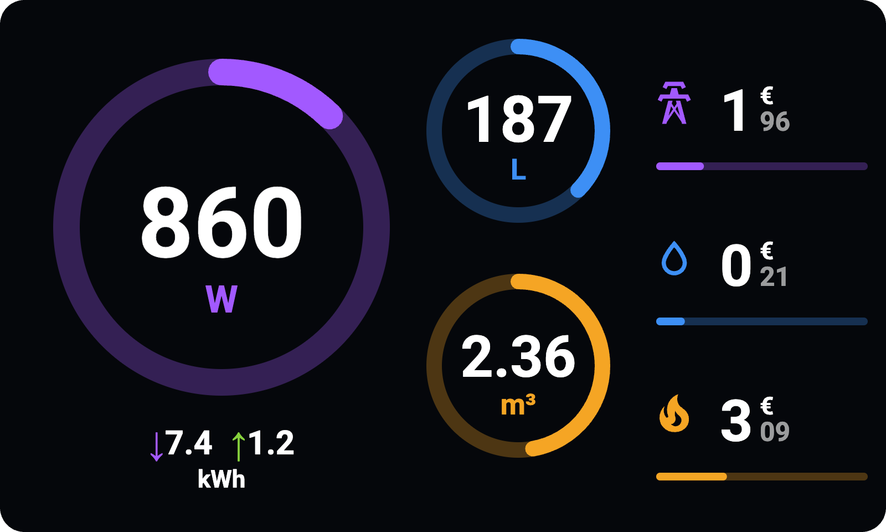
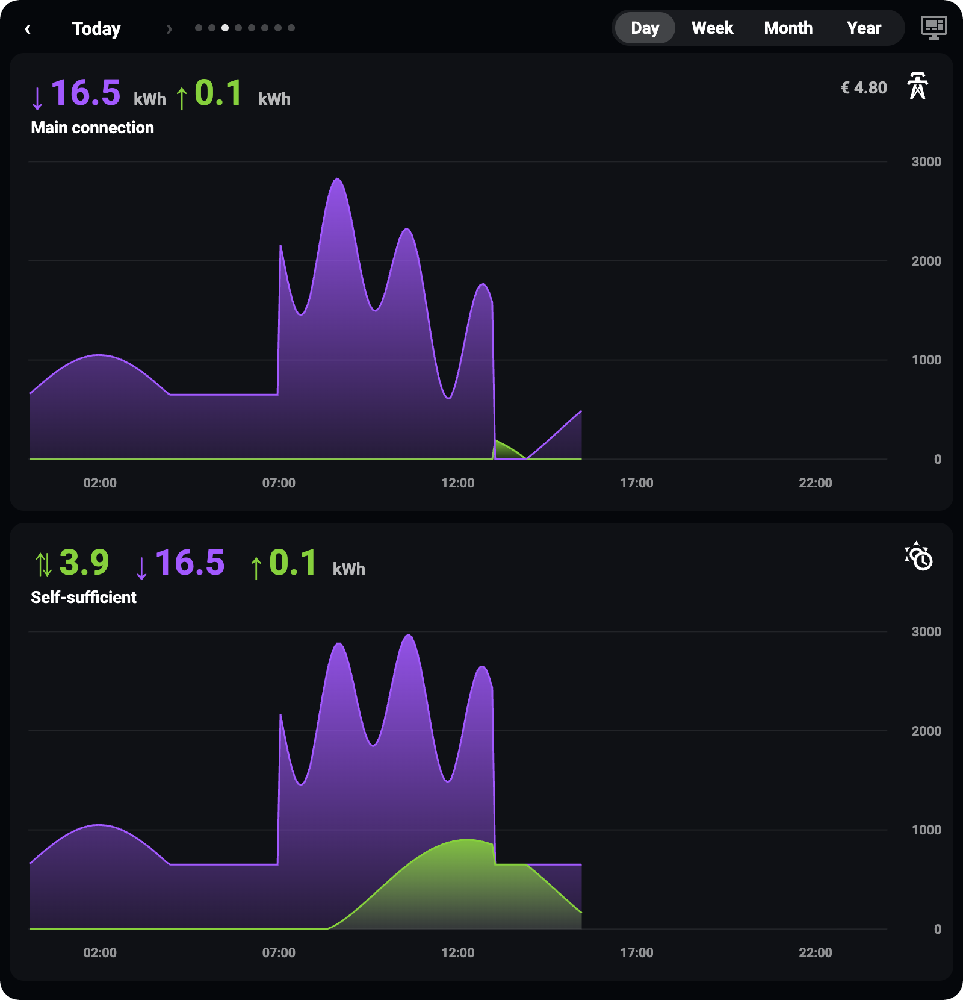

# HomeWizard Display Card

*[English version](README.md)*


Een dashboardkaart voor Home Assistant die het scherm **Usage Overview** van het
[HomeWizard Energy Display](https://www.homewizard.com/nl/energy-display/) nabouwt: drie cirkels en
drie regels met stroom, zon, thuisaccu, water en gas, nu, vandaag of in kosten. Met één tik op de
kaart wissel je naar **grafieken** zoals die van de HomeWizard Energy-app.

 



* **Ingesteld zoals het display.** Elke cirkel en regel toont een bron (hoofdaansluiting,
  zonnepanelen, thuisaccu, water, gas, stroomverbruik, zelfvoorzienend, een stopcontact of
  kWh-meter, of een willekeurige sensor) in een weergave: **Nu**, **Vandaag**, **Auto** of
  **Kosten**, met een maximaal doel.
* **Werkt met je Energie-instellingen.** Net (ook met twee tarieven), zon, thuisaccu's, water, gas
  en hun prijzen worden vanzelf gevonden. De waarden van vandaag komen uit de statistieken van Home
  Assistant, net als bij het Energie-dashboard, en tellen daartussen live door. Meestal zijn er
  geen hulpsensoren nodig.
* **Lijkt op het display.** Afname is paars: ringen vullen rechtsom, balkjes van links naar
  rechts. Levering (teruglevering, zon, een accu die ontlaadt) is groen: ringen vullen linksom,
  balkjes van rechts naar links.
* **Visuele editor** in het Nederlands en Engels, ingedeeld zoals de HomeWizard-app. Getallen
  volgen de getalnotatie van je profiel. Achtergrondkleur naar keuze, voor dag en nacht.
* **Grafieken zoals de HomeWizard-app.** De knop in de hoek van de kaart wisselt naar grafieken
  van water, gas, de hoofdaansluiting, zon, stroomverbruik, zelfvoorzienend, standby-verbruik,
  de thuisaccu en eigen sensoren, per dag, week, maand of jaar. Elke grafiek vult hetzelfde kader
  als het display; je scrolt van grafiek naar grafiek.
* **Eén klein bestand, geen afhankelijkheden.** Past in een secties-weergave en schaalt mee met
  elke breedte.

De gegevens komen uit Home Assistant, bijvoorbeeld van de officiële HomeWizard-integratie. Je hebt
geen HomeWizard Energy Display nodig, en andere meters werken ook.

## Installatie

### Marketplace (Home Assistant 2026.11 en nieuwer)

[](https://my.home-assistant.io/redirect/marketplace_repository/?owner=timoverwoest&repository=homewizard_display_card&category=plugin)

De kaart is aangemeld voor de catalogus van de Marketplace. Tot hij daarin staat, voeg je hem toe
via zijn link:

1. Klik op de knop hierboven. Of ga naar **Instellingen → Marketplace**, kies rechtsboven
   **Add from link**, vul `timoverwoest/homewizard_display_card` in en kies **Add**.
2. Koppel je GitHub-account als daarom wordt gevraagd (eigen repository's hebben dat nodig).
   Herkent de Marketplace het type niet, kies dan **Dashboard**.
3. Kies **Installeren**. De Marketplace voegt de dashboardbron zelf toe.
4. Laad je browser opnieuw.

Staat de kaart eenmaal in de catalogus, dan zoek je onder **Instellingen → Marketplace** gewoon op
**HomeWizard Display Card**. Updates verschijnen onder **Instellingen → Updates**.

### HACS (Home Assistant 2026.10 en ouder)

1. Open HACS, kies **⋮ → Custom repositories**, vul
   `https://github.com/timoverwoest/homewizard_display_card` in met type **Dashboard** en kies
   **Add**.
2. Open **HomeWizard Display Card**, kies **Download** en laad je browser opnieuw.

### Handmatig

1. Download `homewizard_display_card.js` uit de
   [nieuwste release](https://github.com/timoverwoest/homewizard_display_card/releases/latest)
   (het staat in de broncode) en zet het in `/config/www/`.
2. Ga naar **Instellingen → Dashboards → ⋮ → Bronnen** en voeg
   `/local/homewizard_display_card.js?v=0.4.0` toe als **JavaScript-module**.
3. Laad je browser opnieuw. Verhoog `?v=` bij elke nieuwe versie.

## Instellen

Voeg de kaart toe via de kaartkiezer (zoek op "HomeWizard"). De editor is ingedeeld zoals de
display-instellingen in de HomeWizard-app: per cirkel en regel een blok (**Cirkel 1–3**,
**Bovenaan**, **Midden**, **Onderaan**) met wat het toont, de weergave en de maximale doelen,
daarna de achtergrondkleur, de sensoren en de andere kleuren.

In YAML is de kortste versie:

```yaml
type: custom:homewizard-display-card
```

Dat geeft de standaard Usage Overview van het display, gevuld uit je
[Energie-instellingen](https://my.home-assistant.io/redirect/config_energy/):

| Plek | Sleutel | Standaard |
|------|---------|-----------|
| Cirkel 1 (groot) | `circle_1` | Hoofdaansluiting, nu, doel 7000 W |
| Cirkel 2 | `circle_2` | Thuisaccu, doel 100 % |
| Cirkel 3 | `circle_3` | Zonnepanelen, vandaag, doel 25 kWh |
| Bovenaan | `top` | Hoofdaansluiting, vandaag, doel 25 kWh |
| Midden | `middle` | Zonnepanelen, vandaag, doel 25 kWh |
| Onderaan | `bottom` | Water, auto, doelen 10 L/min en 500 L |

### Wat een cirkel of regel kan tonen

Elke plek krijgt `source`, `mode` en de doelen die bij die weergave horen.

| `source` | Nu (`goal_now`) | Vandaag (`goal_today`) | Auto | Kosten (`goal_cost`) |
|----------|-----------------|------------------------|------|----------------------|
| `grid`: hoofdaansluiting | Vermogen in W; groen bij teruglevering (7000 W) | Afgenomen van het net, kWh (25 kWh) | – | Kosten van vandaag min de vergoeding (10) |
| `solar`: zonnepanelen | Opwek in W (5000 W) | Opwek in kWh (25 kWh) | ✓ | – |
| `battery`: thuisaccu | Laadstand in % (100 %) | – | – | – |
| `water` | Debiet in L/min (10 L/min) | Liters (500 L) | ✓ | Kosten van vandaag (2) |
| `gas` | Debiet in m³/h (2 m³/h) | m³, of kWh bij een gasmeter in kWh (5) | ✓ | Kosten van vandaag (10) |
| `consumption`: stroomverbruik van het huis | W (7000 W) | kWh (25 kWh) | – | – |
| `self_sufficiency`: deel dat niet van het net kwam | % (100 %) | % (100 %) | – | – |
| `device`: Energy Socket, kWh-meter en dergelijke | W uit `power`; negatief = opwek (3000 W) | kWh uit `energy` (10 kWh) | ✓ | – |
| `entity`: elke sensor, bijvoorbeeld een temperatuur | Waarde en eenheid van `entity` (100) | – | – | – |
| `none` | Niets | | | |

* **Auto** toont *nu* zolang er iets stroomt of wordt opgewekt, en *vandaag* als dat 0 is.
* **Kosten** gebruiken de prijzen uit je Energie-instellingen; Home Assistant maakt de
  kostensensoren zelf. De munteenheid volgt je instellingen van Home Assistant. Een negatieve
  waarde (je verdiende meer dan je betaalde) staat in het groen.
* **Stroomverbruik** en **zelfvoorzienend** worden berekend uit het net, de zonnepanelen en de
  thuisaccu's in je Energie-instellingen, op dezelfde manier als het Energie-dashboard.
* Onder de grote ring zie je, als die de hoofdaansluiting toont, ↓ afname en ↑ teruglevering van
  vandaag, zoals op het display. Lever je terug, dan toont een grote ring in de weergave
  *vandaag* wat je vandaag terugleverde.
* Een doel is de waarde waarbij de ring of het balkje vol is. Met `color` krijgt één cirkel of
  regel een eigen kleur.

### Grafieken



Tik op de knop rechtsboven in de kaart om te wisselen tussen het display en de grafieken, zoals de
wisselknoppen op het Energie-dashboard. De kaart houdt de afmeting van het display: elke grafiek
vult het kader en je scrolt (muiswiel, vegen of pijltjestoetsen) van de ene grafiek naar de volgende; de bolletjes
laten zien waar je bent. Boven de grafieken kies je **Dag**, **Week**, **Maand** of **Jaar**, en
met ‹ en › ga je terug in de tijd. Wijs een grafiek aan of tik erop om de waarde op dat moment te
zien.

* **Dag** toont het gemiddelde vermogen per 5 minuten als vlak, zoals de app. Week, maand en jaar
  tonen kWh (of liters, m³) per uur, dag of maand als staafjes.
* De grafieken gebruiken de kleuren van het display: paars voor afname van het net en
  stroomverbruik, groen voor teruglevering, zon en je eigen energie (zelfvoorzienend), blauw voor
  water, oranje voor gas. Een kleur die je bij een cirkel of regel instelt, telt ook mee; tonen een
  cirkel en een regel dezelfde bron in verschillende kleuren, dan wint de cirkel. Alleen in de
  grafieken andere kleuren? Stel ze in onder **Grafiekkleuren (optioneel)** (`chart_color_*`
  hieronder); een leeg veld houdt de kleur van het display.
* De grafieken worden op de echte afmeting van de kaart getekend, zodat assen en waarden op een
  telefoon even goed leesbaar zijn als op een breed scherm. Op een smalle kaart tonen de assen
  minder labels.
* **Standby-verbruik** is het vermogen dat je huis altijd blijft gebruiken: de laagste 5 % van de
  gemiddelden in de periode.
* Alles komt uit de statistieken van Home Assistant, met dezelfde bronnen als het display. Home
  Assistant bewaart 5-minutenstatistieken ongeveer tien dagen; oudere dagen worden per uur getoond.

| Optie | Standaard | Uitleg |
|-------|-----------|--------|
| `view` | `display` | Wat de kaart eerst toont: `display` of `charts`. |
| `show_view_switch` | `true` | De knop op de kaart om tussen de twee te wisselen. |
| `charts` | alle met gegevens | Welke grafieken, in deze volgorde: `water`, `gas`, `grid`, `solar`, `consumption`, `self_sufficiency`, `standby`, `battery`. |
| `chart_entities` | geen | Eigen sensoren als extra grafiek, bijvoorbeeld een temperatuur of luchtvochtigheid. |
| `period` | `day` | De periode waarmee de grafieken beginnen: `day`, `week`, `month` of `year`. |
| `chart_color_grid` | display | Afname van het net. |
| `chart_color_delivery` | display | Teruglevering aan het net. |
| `chart_color_solar` | display | Zonnepanelen. |
| `chart_color_consumption` | display | Stroomverbruik en standby-verbruik. |
| `chart_color_self_sufficiency` | zon | Je eigen energie in Zelfvoorzienend; leeg = de kleur van de zonnepanelen. |
| `chart_color_battery` | display | Thuisaccu. |
| `chart_color_water` | display | Water. |
| `chart_color_gas` | display | Gas. |

### Sensoren

Elke waarde kan uit een eigen entiteit komen; velden die je leeg laat, worden aangevuld uit de
Energie-instellingen.

| Optie | Uitleg |
|-------|--------|
| `grid_power` | Vermogen van de netaansluiting: positief = afname van het net, negatief = teruglevering. W of kW. |
| `grid_import`, `grid_export` | Meter(s) voor afname van en teruglevering aan het net. Eén entiteit of een lijst, bijvoorbeeld één per tarief. |
| `solar_power`, `solar_energy` | Vermogen en opbrengstmeter(s) van de zonnepanelen. |
| `battery_soc` | Laadstand (%). Een lijst van meerdere accu's geeft het gemiddelde. |
| `battery_power` | Vermogen van de accu. Een lijst wordt opgeteld. Bepaalt wanneer de accu levert. |
| `battery_power_sign` | `discharge_positive` (standaard, de afspraak van Home Assistant) of `charge_positive` als je `battery_power`-sensor **laden** als positief telt, zoals de HomeWizard Plug-In Battery. Accu's uit de Energie-instellingen volgen altijd de afspraak van Home Assistant. |
| `water`, `water_flow` | Watermeter(s) en de debietsensor (L/min, m³/h enzovoort). |
| `gas`, `gas_flow` | Gasmeter(s) en een debietsensor (m³/h). |
| `use_energy_settings` | `false`: alleen de entiteiten gebruiken die je zelf instelt. Standaard `true`. |

Meters mogen totaalmeters zijn, zoals in de Energie-instellingen, of dagtellers zoals een
Nutsmeter die om middernacht op nul gaat. De kaart vraagt in beide gevallen de verandering van
vandaag op uit de statistieken van Home Assistant. Een entiteit zonder statistieken wordt getoond
zoals hij is.

### Kleuren

| Optie | Standaard | Gebruikt voor |
|-------|-----------|---------------|
| `color_background` | `#05070b` (het zwart van het display) | Achtergrond overdag (licht thema); elke hex-kleur, zoals `#000000` of `#f4f4f4` |
| `color_background_dark` | zelfde als overdag | Achtergrond 's nachts (donker thema) |
| `color_grid` | `#a259ff` | Hoofdaansluiting en stroomverbruik |
| `color_delivery` | `#86d03c` | Levering: teruglevering, zon, een accu die ontlaadt, zelfvoorzienend |
| `color_battery` | `#b9d2e0` | Thuisaccu zolang die niet levert, en eigen sensoren |
| `color_water` | `#3d8ff5` | Water |
| `color_gas` | `#f5a524` | Gas |
| `color_text` | automatisch | Getallen: wit op een donkere achtergrond, bijna zwart op een lichte |

**Dag en nacht.** De kaart volgt de lichte of donkere modus van Home Assistant, net als de rest
van je dashboard: in je profiel volgt **Thema** op *Automatisch* je apparaat, of kies *Licht* of
*Donker*. In de donkere modus gebruikt de kaart `color_background_dark`; laat die leeg voor één
achtergrond.

Standaard is de kaart zwart zoals het display, overdag en 's nachts. De editor stelt twee kleuren
voor die juist opgaan in het thema: **licht `#f4f5f7`** overdag en **donkergrijs `#1c1c1c`** (de
kaartkleur van het donkere thema) 's nachts. Je kunt ook een eigen hex-kleur typen.

```yaml
type: custom:homewizard-display-card
color_background: "#f4f5f7"
color_background_dark: "#1c1c1c"
```

Op een lichte achtergrond gebruikt de kaart donkerdere varianten van de accentkleuren, zodat
ringen, balkjes en eenheden leesbaar blijven: `#7c3aed` voor het net, `#4d8f1a` voor levering,
`#6d8fa3` voor de accu, `#1f6fd6` voor water en `#c27a00` voor gas. Kleuren die je zelf instelt,
blijven zoals ze zijn.

### Voorbeeld

Gas in cirkel 3, water met zijn debietsensor onderaan, en een iets lichtere achtergrond:

```yaml
type: custom:homewizard-display-card
circle_1:
  source: grid
  mode: now
  goal_now: 7000
circle_3:
  source: gas
  mode: today
  goal_today: 4
bottom:
  source: water
  mode: auto
  goal_now: 10
  goal_today: 500
water_flow: sensor.watermeter_active_water_usage
gas: sensor.p1_meter_total_gas
color_background: "#101418"
```

## Heb ik hulpsensoren nodig?

Meestal niet. Dit rekent de kaart zelf uit: de totalen van vandaag (uit de statistieken), kosten
(uit de Energie-instellingen), stroomverbruik en zelfvoorzienendheid, meerdere tarieven
(opgeteld) en meerdere accu's (gemiddelde laadstand, totaal vermogen). Alleen in deze gevallen heb
je een hulpsensor nodig. Hulpsensoren maak je onder **Instellingen → Apparaten & diensten →
Helpers → Helper aanmaken**.

| Wanneer | Waarom | Hoe |
|---------|--------|-----|
| Je wilt water of gas in **nu** of **auto**, maar de meter heeft geen debietsensor (bijvoorbeeld de gasmeter via de P1-meter, of een watermeter zonder) | Nu heeft een debiet nodig | **Afgeleide sensor** op de water- of gasmeter. Tijdseenheid **minuten** voor water (geeft m³/min, de kaart rekent om naar L/min), **uren** voor gas (geeft m³/h). Een tijdvenster van 5 minuten strijkt de stapjes van de meter glad. Zet hem in `water_flow` of `gas_flow`. |
| Je wilt zon in **nu**, maar de omvormer heeft alleen een energiemeter | Nu heeft vermogen nodig | **Afgeleide sensor** op de zonnemeter met tijdseenheid **uren** (kWh/h is kW). Zet hem in `solar_power`. |
| Je netvermogen telt teruglevering als positief, of afname en teruglevering zijn twee sensoren | De kaart wil één sensor, positief = afname | Het beste: vul hem in de Energie-instellingen in bij het vermogen van het net (als *omgekeerd* of als *twee sensoren*); Home Assistant maakt dan de juiste sensor en de kaart vindt hem. Anders een **Sjabloonsensor** met `{{ -(states('sensor.grid_power') | float(0)) }}` of afname min teruglevering. |
| Je wilt **kosten**, maar hebt geen prijzen in de Energie-instellingen | Kosten komen uit de kostensensoren van Home Assistant | Geen hulpsensor: voeg de prijs (vast, of een entiteit met de actuele prijs) toe aan de meter in de Energie-instellingen. |
| Een meter heeft geen statistieken (geen state class) | Vandaag komt uit de statistieken | **Nutsmeter** op die meter met resetcyclus *dagelijks*; die heeft wel statistieken. |
| Je wilt gas, maar het staat niet in de Energie-instellingen | – | Geen hulpsensor: zet `gas` op je gasmeter. Voor gaskosten voeg je gas met zijn prijs toe aan de Energie-instellingen. |

Telt je accu laden als positief? Geen hulpsensor: zet `battery_power_sign: charge_positive`.

## Hoe "vandaag" werkt

De kaart leest de verandering van vandaag per meter uit de statistieken van de recorder, dezelfde
gegevens als het Energie-dashboard. De dag begint om middernacht in de tijdzone van Home Assistant.
Statistieken worden elke 5 minuten opgeslagen; daartussen telt de kaart op wat de meter sinds de
laatste statistiek bijhield, zodat de getallen blijven lopen.

Het HomeWizard Energy Display zet zijn dagtotalen 's nachts om 2.00 uur op nul. Tussen middernacht
en twee uur, en in de totalen van de dag, kunnen zijn getallen daardoor afwijken van die op de
kaart.

## Opmerkingen

* De indeling ligt vast op het scherm Usage Overview: drie cirkels en drie regels.
* Gemaakt met de HomeWizard-integratie in gedachten (P1-meter, watermeter, Energy Socket,
  kWh-meter, Plug-In Battery), maar elke sensor met een ondersteunde eenheid werkt.

## Ontwikkelen

De kaart is één JavaScript-bestand zonder bouwstap. Tests voor de logica:

```bash
node tests/run-node.js
```

Op een Mac zonder Node werkt JavaScriptCore ook:

```bash
/System/Library/Frameworks/JavaScriptCore.framework/Versions/A/Helpers/jsc homewizard_display_card.js tests/test.js
```

Voor een visuele controle: serveer de root van de repository (bijvoorbeeld
`python3 -m http.server 8765`) en open `http://localhost:8765/tests/demo.html`. Die pagina gebruikt
een nagemaakte Home Assistant met demowaarden.

De code volgt de
[coding guidelines van de Home Assistant-frontend](https://contributors.home-assistant.io/frontend/development/guidelines/)
en de pagina's over [custom cards](https://contributors.home-assistant.io/frontend/custom-ui/card/).
Welke versie je browser geladen heeft, zie je met
`customElements.get("homewizard-display-card").version` in de console van de browser.

## Credits en disclaimer

Geïnspireerd op het [HomeWizard Energy Display](https://www.homewizard.com/nl/energy-display/) en
de grafieken van de [HomeWizard Energy-app](https://hwenergy.app).
[HomeWizard](https://www.homewizard.com/nl/) en HomeWizard Energy zijn merken van
HomeWizard B.V. Dit is een onafhankelijk communityproject; het heeft geen formele band met
HomeWizard en wordt niet door HomeWizard goedgekeurd of gesponsord. Het logo is een eigen ontwerp
en niet het logo van HomeWizard.

Iconen in de kaart: [Material Design Icons](https://pictogrammers.com/library/mdi/) van
Pictogrammers, Apache License 2.0.

## Licentie

MIT, zie [LICENSE](LICENSE).
