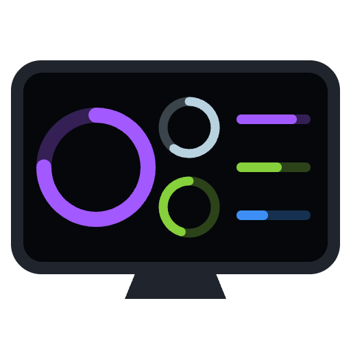
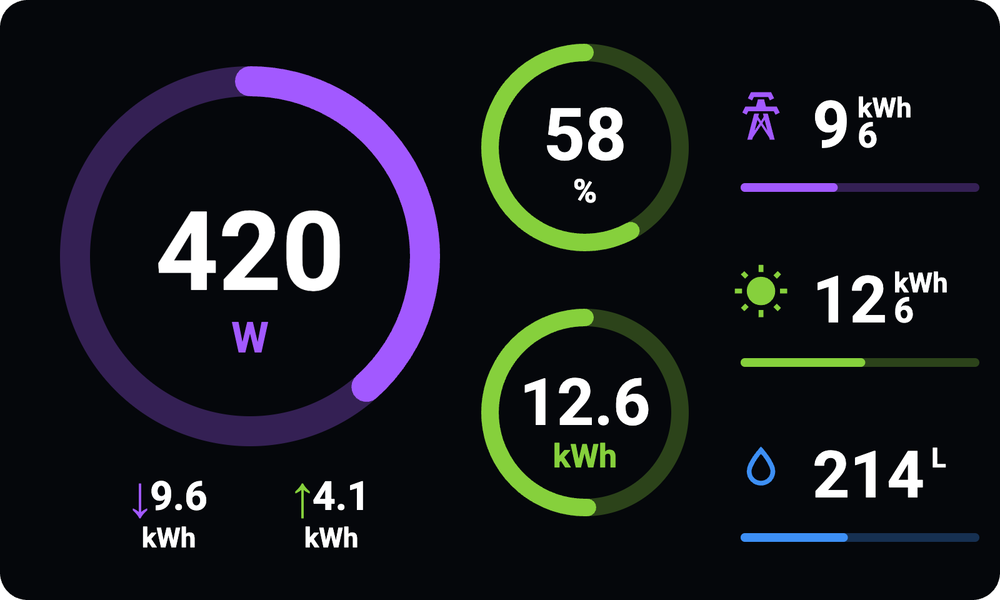

# HomeWizard Display Card

*[English version](README.md)*



Een dashboardkaart voor Home Assistant die het scherm **Usage Overview** van het HomeWizard Energy
Display nabouwt: netvermogen, afname en teruglevering van vandaag, thuisaccu, zon en water in één
oogopslag.

 

* **Werkt met je Energie-instellingen.** Net (ook met twee tarieven), zon, thuisaccu en water
  worden vanzelf gevonden. Geen hulpsensoren nodig: net als het Energie-dashboard haalt de kaart
  de waarden van vandaag uit de statistieken van Home Assistant, en telt daartussen live door.
* **Lijkt op het display.** Afname is paars en loopt rechtsom; levering (teruglevering, zon, een
  accu die ontlaadt) is groen en loopt linksom.
* **Visuele editor** in het Nederlands en Engels. Getallen volgen de getalnotatie van je profiel.
* **Eén klein bestand, geen afhankelijkheden.** Past in een secties-weergave en schaalt mee met
  elke breedte.

De gegevens komen uit Home Assistant, bijvoorbeeld van de officiële HomeWizard-integratie. Je hebt
geen HomeWizard Energy Display nodig, en andere meters werken ook.

## Wat de kaart toont

| Onderdeel | Toont |
|-----------|-------|
| Grote ring | Netvermogen nu (W, vanaf 10 kW in kW). De boog is de energie die je vandaag van het net **afnam**, tegen het doel: paars, rechtsom. Lever je terug aan het net, dan wordt de ring groen en linksom en is de boog de energie die je vandaag **terugleverde**. Onder de ring: ↓ afname vandaag en ↑ teruglevering vandaag (vanaf 0,05 kWh). |
| Kleine ring boven | Laadstand van de thuisaccu. Groen en linksom zolang de accu levert (meer dan 20 W). |
| Kleine ring onder | Zonne-energie van vandaag tegen het doel: altijd groen en linksom. |
| Rechterkolom | Afname van het net vandaag, zon vandaag, en water: liters vandaag, of het debiet in L/min zolang er water loopt. Elk met een balk tegen het doel. |

## Installatie

### Marketplace (Home Assistant 2026.11 en nieuwer)

[](https://my.home-assistant.io/redirect/marketplace_repository/?owner=timoverwoest&repository=homewizard_display_card&category=plugin)

De kaart is aangemeld voor de catalogus van de Marketplace. Tot hij daarin staat, voeg je hem toe
via zijn link:

1. Klik op de knop hierboven. Of ga naar **Instellingen → Marketplace**, kies rechtsboven
   **Add from link**, vul `timoverwoest/homewizard_display_card` in en kies **Add**.
2. Koppel je GitHub-account als daarom wordt gevraagd (eigen repository's hebben dat nodig).
   Herkent de Marketplace het type niet, kies dan **Dashboard**.
3. Kies **Installeren**. De Marketplace voegt de dashboardbron zelf toe.
4. Laad je browser opnieuw.

Staat de kaart eenmaal in de catalogus, dan zoek je onder **Instellingen → Marketplace** gewoon op
**HomeWizard Display Card**. Updates verschijnen onder **Instellingen → Updates**.

### HACS (Home Assistant 2026.10 en ouder)

1. Open HACS, kies **⋮ → Custom repositories**, vul
   `https://github.com/timoverwoest/homewizard_display_card` in met type **Dashboard** en kies
   **Add**.
2. Open **HomeWizard Display Card**, kies **Download** en laad je browser opnieuw.

### Handmatig

1. Download `homewizard_display_card.js` uit de
   [nieuwste release](https://github.com/timoverwoest/homewizard_display_card/releases/latest)
   (het staat in de broncode) en zet het in `/config/www/`.
2. Ga naar **Instellingen → Dashboards → ⋮ → Bronnen** en voeg
   `/local/homewizard_display_card.js?v=0.1.0` toe als **JavaScript-module**.
3. Laad je browser opnieuw. Verhoog `?v=` bij elke nieuwe versie.

## Instellen

Voeg de kaart toe via de kaartkiezer (zoek op "HomeWizard"), of in YAML:

```yaml
type: custom:homewizard-display-card
```

Meer is niet nodig als je [Energie-instellingen](https://my.home-assistant.io/redirect/config_energy/)
klaar zijn. Elke waarde kan ook uit een eigen entiteit komen; velden die je leeg laat, worden
aangevuld uit de Energie-instellingen.

| Optie | Standaard | Uitleg |
|-------|-----------|--------|
| `grid_power` | Energie-instellingen | Vermogenssensor van de netaansluiting: positief = afname van het net, negatief = teruglevering. W of kW. |
| `grid_import` | Energie-instellingen | Meter(s) voor afname van het net. Eén entiteit of een lijst, bijvoorbeeld één per tarief. |
| `grid_export` | Energie-instellingen | Meter(s) voor teruglevering aan het net. |
| `solar_energy` | Energie-instellingen | Opbrengstmeter(s) van de zonnepanelen. |
| `battery_soc` | Energie-instellingen | Laadstand van de thuisaccu (%). Meerdere accu's in de Energie-instellingen: het gemiddelde. |
| `battery_power` | Energie-instellingen | Vermogen van de thuisaccu. Alleen gebruikt om te zien wanneer de accu levert. |
| `battery_power_sign` | `discharge_positive` | Zet op `charge_positive` als je `battery_power`-sensor **laden** als positief telt, zoals de HomeWizard Plug-In Battery. Accu's uit de Energie-instellingen volgen altijd de afspraak van Home Assistant. |
| `water` | Energie-instellingen | Watermeter(s). |
| `water_flow` | Energie-instellingen | Sensor voor het waterdebiet (L/min, m³/h enzovoort). |
| `water_display` | `auto` | `auto`: het debiet zolang er water loopt, anders liters vandaag. `volume` of `flow` toont altijd die. |
| `use_energy_settings` | `true` | `false`: alleen de entiteiten gebruiken die je zelf instelt. |
| `goal_grid_import` | `25` | Dagdoel in kWh voor afname van het net. |
| `goal_grid_export` | `25` | Dagdoel in kWh voor teruglevering. |
| `goal_solar` | `25` | Dagdoel in kWh voor zon. |
| `goal_water` | `500` | Dagdoel in liters. |
| `goal_water_flow` | `10` | Doel voor het debiet in L/min. |
| `color_grid` | `#a259ff` | Kleur voor afname van het net. |
| `color_delivery` | `#86d03c` | Kleur voor levering: teruglevering, zon, een accu die ontlaadt. |
| `color_battery` | `#b9d2e0` | Kleur van de accuring als de accu niet levert. |
| `color_water` | `#3d8ff5` | Kleur voor water. |
| `color_text` | `#ffffff` | Kleur van de getallen. |
| `color_background` | `#05070b` | Achtergrondkleur. |

Meters (`grid_import`, `grid_export`, `solar_energy`, `water`) mogen totaalmeters zijn, zoals in de
Energie-instellingen, of dagtellers zoals een Nutsmeter die om middernacht op nul gaat. De kaart
vraagt in beide gevallen de verandering van vandaag op uit de statistieken van Home Assistant. Een
entiteit zonder statistieken wordt getoond zoals hij is.

### Voorbeeld: eigen entiteiten

```yaml
type: custom:homewizard-display-card
grid_power: sensor.grid_power
grid_import:
  - sensor.energy_import_tariff_1
  - sensor.energy_import_tariff_2
battery_soc: sensor.plug_in_battery_state_of_charge
battery_power: sensor.plug_in_battery_power
battery_power_sign: charge_positive
goal_grid_import: 15
goal_water: 300
```

## Hoe "vandaag" werkt

De kaart leest de verandering van vandaag per meter uit de statistieken van de recorder, dezelfde
gegevens als het Energie-dashboard. De dag begint om middernacht in de tijdzone van Home Assistant.
Statistieken worden elke 5 minuten opgeslagen; daartussen telt de kaart op wat de meter sinds de
laatste statistiek bijhield, zodat de getallen blijven lopen.

Het HomeWizard Energy Display kan zijn dag op een iets ander moment laten beginnen, waardoor zijn
getallen een beetje kunnen afwijken van die op de kaart.

## Opmerkingen

* De indeling ligt in deze versie vast op het scherm Usage Overview.
* Hebben je Energie-instellingen geen vermogenssensor voor het net, de accu of het waterdebiet,
  stel dan zelf `grid_power`, `battery_power` of `water_flow` in.
* Gemaakt met de HomeWizard-integratie in gedachten (P1-meter, watermeter, Plug-In Battery), maar
  elke sensor met een ondersteunde eenheid werkt.

## Ontwikkelen

De kaart is één JavaScript-bestand zonder bouwstap. Tests voor de logica:

```bash
node tests/run-node.js
```

Op een Mac zonder Node werkt JavaScriptCore ook:

```bash
/System/Library/Frameworks/JavaScriptCore.framework/Versions/A/Helpers/jsc homewizard_display_card.js tests/test.js
```

Voor een visuele controle: serveer de root van de repository (bijvoorbeeld
`python3 -m http.server 8765`) en open `http://localhost:8765/tests/demo.html`. Die pagina gebruikt
een nagemaakte Home Assistant met demowaarden.

## Credits en disclaimer

Geïnspireerd op het HomeWizard Energy Display. HomeWizard en HomeWizard Energy zijn merken van
HomeWizard B.V. Dit is een onafhankelijk communityproject; het heeft geen formele band met
HomeWizard en wordt niet door HomeWizard goedgekeurd of gesponsord. Het logo is een eigen ontwerp
en niet het logo van HomeWizard.

Iconen in de kaart: [Material Design Icons](https://pictogrammers.com/library/mdi/) van
Pictogrammers, Apache License 2.0.

## Licentie

MIT, zie [LICENSE](LICENSE).
